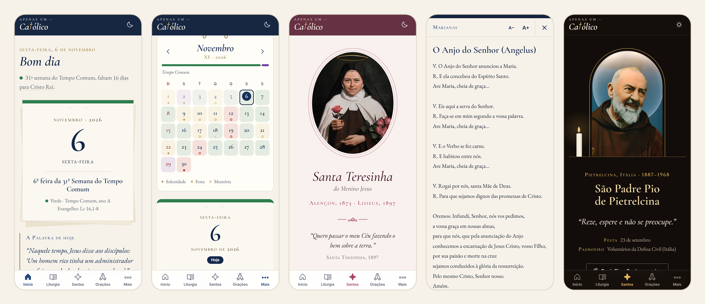
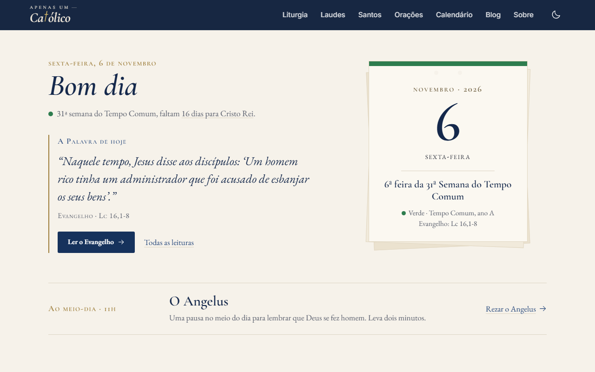
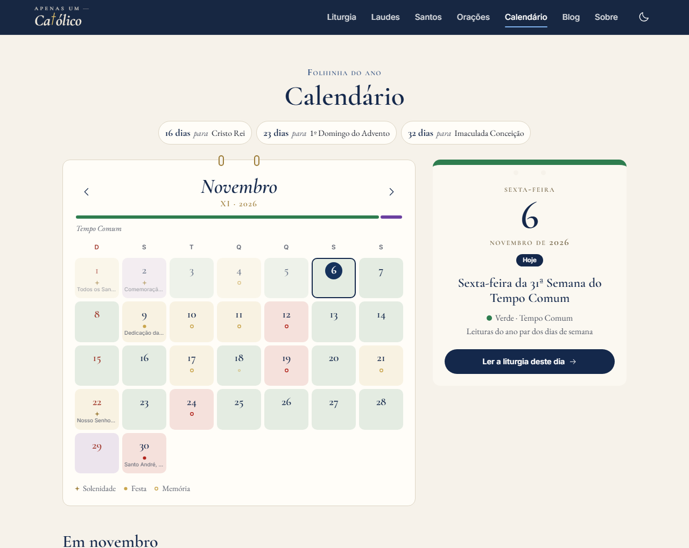
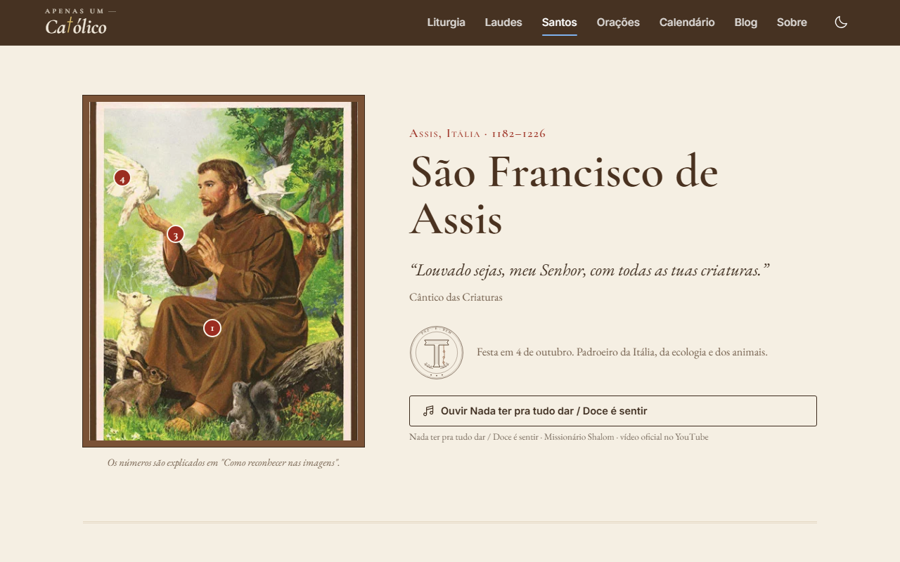
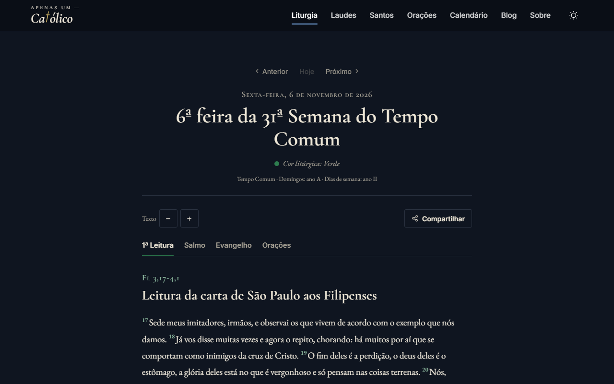

# Apenas um Católico

Site católico para rezar todos os dias: a liturgia de hoje, a vida dos santos, orações e o calendário litúrgico. Pensado primeiro para o celular, com cara de missal: papel marfim, azul-marinho, dourado velho e tipografia serifada.

**No ar:** https://joaocarlosteco.github.io/Apenas-um-Catolico/



| Início | Calendário |
| --- | --- |
|  |  |
| **São Francisco** | **Liturgia Diária (tema escuro)** |
|  |  |

## O que tem

- **Início que acompanha o dia.** A folhinha do dia com a celebração e a cor litúrgica, a primeira frase do Evangelho, uma oração para a hora em que o site é aberto (Laudes de manhã, Angelus ao meio-dia, terço à tarde, ato de contrição à noite), a semana em quadradinhos coloridos e a próxima festa de um dos santos do site.
- **Liturgia Diária.** Primeira leitura, salmo, segunda leitura, Evangelho e orações da Missa de qualquer data, com as leituras alternativas quando o dia tem mais de uma, versículos numerados, tamanho de letra ajustável e link de cada dia para compartilhar.
- **Calendário em folhinha.** O mês em grade, cada dia com o fundo na cor litúrgica e marcas para solenidade, festa e memória. Tocar num dia mostra o que se celebra, a cor, o ano das leituras, a novena em andamento e o caminho para a liturgia daquele dia.
- **Ano litúrgico calculado no navegador, com as regras do Brasil.** Páscoa pelo cômputo gregoriano, festas móveis, tempo e semana de qualquer dia, ciclos A, B, C e I, II, e a celebração de cada dia pela tabela de precedência. Epifania e Ascensão no domingo; Pedro e Paulo, Assunção e Todos os Santos passam para o domingo; memórias próprias do Brasil (Anchieta, Santa Paulina, Frei Galvão, Irmã Dulce, mártires de Cunhaú e Uruaçu). O resultado foi comparado dia a dia com a liturgia oficial e é coberto por testes.
- **Uma página diferente para cada santo.** Cada santo tem o seu próprio desenho de página, não um molde com cores trocadas, e uma medalha desenhada em SVG:
  - São Francisco: manuscrito iluminado, o Cântico das Criaturas e os Fioretti;
  - Santa Teresinha: caderno e santinho, a pequena via e a chuva de rosas;
  - Padre Pio: capela à luz de vela, as chagas e os milagres reconhecidos;
  - Nossa Senhora: manto e ladainha, as aparições e um terço interativo com os mistérios do dia.
- **Aprofundamento em cada santo.** Como reconhecer nas imagens, escritos com a fonte, frases famosas que não são do santo, lugares para visitar, o que ler e uma novena de nove dias que guarda o progresso no aparelho.
- **Música de cada santo.** Cantos do Missionário Shalom e da Comunidade Católica Shalom pelos vídeos oficiais no YouTube: "Nada ter pra tudo dar / Doce é sentir" para Francisco, "O Elevador" para Teresinha, "Fica, Senhor, comigo" para Pio e "Todo Teu, ó Mãe" para Nossa Senhora. O player abre pequeno no lugar do botão, só depois de um clique, e repete a música. Cada santo também tem uma gravação livre do Wikimedia Commons cadastrada como alternativa (`src/data/musicas.js`).
- **Orações.** Lista compacta por momento do dia e por categoria, busca sem acento e um leitor que abre a oração inteira, com link próprio (`/oracao?oracao=angelus`).
- **Laudes e Blog.** As Laudes são um roteiro local, porque não existe API pública do Ofício em português.
- **Tema claro e escuro**, que segue o sistema e guarda a escolha.
- **PWA.** Pode ser instalado no celular e abre sem internet as páginas já visitadas.
- **Navegação de aplicativo no celular**, com barra inferior: Início, Liturgia, Santos, Orações e Mais.

## Tecnologias

- React 18 (Create React App), JavaScript e TypeScript
- styled-components, com o tema claro e o escuro definidos por tokens
- React Router 6, com cada página baixada só quando é aberta (`React.lazy`) e uma cópia do `index.html` por rota, para links diretos responderem 200 no GitHub Pages
- Animações em CSS, sem biblioteca de animação
- react-icons, react-helmet, Service Worker para o modo offline
- API pública [liturgia-diaria](https://github.com/Dancrf/liturgia-diaria) (rota v2, com `?dia=&mes=&ano=` e `?periodo=7`)

## Como rodar

```bash
npm install
npm start
```

Abre em `http://localhost:3000/Apenas-um-Catolico`.

Para ver o build do jeito que o GitHub Pages serve:

```bash
npm run build
npm run preview
```

Abre em `http://localhost:3003/Apenas-um-Catolico/`.

Testes (ano litúrgico e calendário):

```bash
npm test
```

## Publicação

```bash
npm run deploy
```

Gera o build e publica a pasta `build/` no branch `gh-pages`. O `postbuild` (`scripts/rotas-estaticas.js`) cria uma página para cada rota, inclusive as dos santos, que são lidas de `src/data/santos.js`.

## Estrutura

```
src/
  pages/          páginas (Home, LiturgiaDiaria, Calendario, Oracao, Santos, Sobre, ...)
  pages/santos/   uma página por santo (PaginaFrancisco, PaginaTeresinha, PaginaPio, PaginaMaria) e o que elas compartilham
  components/     Header, Footer, Logo, Emblemas (SVG), Folhinha, RodaLiturgica, Terco, Novena, BotaoMusica
  data/           santos, santosExtras, oracoes, calendario (celebrações fixas) e musicas
  services/       liturgia.js (API e cache), anoLiturgico.js (Páscoa, tempos e ciclos),
                  calendarioLiturgico.js (celebração de cada dia, com as regras do Brasil)
  styles/         tema claro e escuro
scripts/          rotas estáticas do build e servidor de prévia
docs/capturas/    imagens deste README
```

## Créditos

Textos da liturgia: API [liturgia-diaria](https://github.com/Dancrf/liturgia-diaria). Músicas: vídeos oficiais do Missionário Shalom e da Comunidade Católica Shalom no YouTube e gravações livres do Wikimedia Commons. Imagens dos santos: acervo do projeto.
